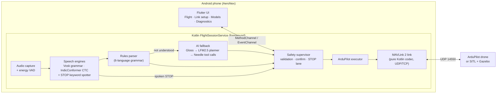
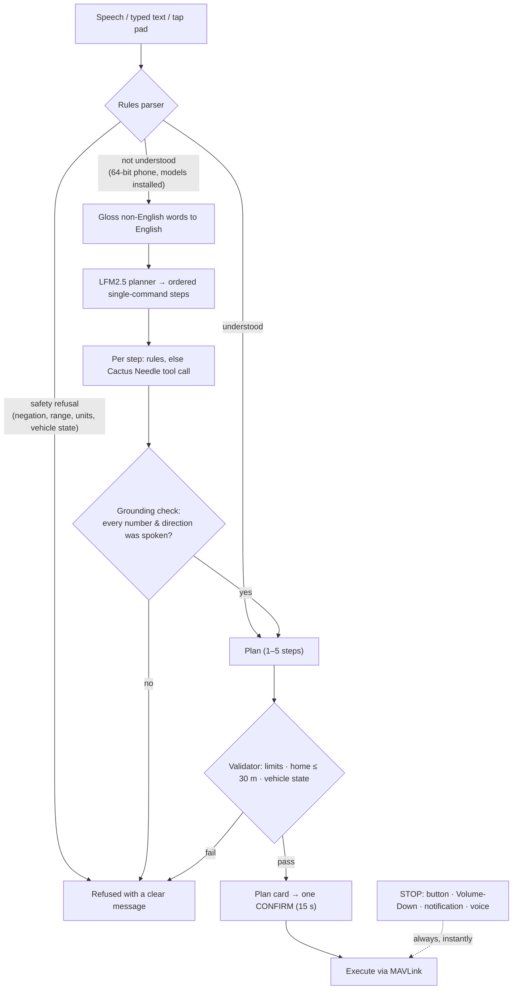

# AeroNex

**Fly a drone with your voice — in your own language, offline, on any Android phone.**

AeroNex turns natural speech in **English, Hindi, Telugu, Tamil, Kannada and Malayalam** into safe, confirmed flight plans for **ArduPilot** drones. Speech recognition, command understanding and the AI planner all run **on the phone, with no internet**. A safety supervisor sits between every command and the aircraft, and an emergency **STOP** always works: on screen, with the volume key, from the notification, or by saying "stop".


---

## 🏆 Yukthi Hackathon — Team Infinity

| Team | Members |
|---|---|
| **Infinity** | **Devineni Yugash** · **Devathi Naga Shamika** · **Evuri Harika** · **Comojappa Keerthi** |

---

## 1. The problem

Drones are becoming everyday tools for agriculture, disaster response, surveying and delivery, but flying one still needs a trained pilot, a radio controller and an English-language ground-control app. That shuts out the people who could use drones most: farmers, first responders and field workers across India who speak Hindi, Telugu, Tamil, Kannada or Malayalam, often in places with **no internet**, using **low-cost phones**.

Voice control could fix this, but most voice assistants need the cloud, speak only English, and can mishear a command. In the air, a misheard "**don't** take off" or "move **20** metres" is a crash.

## 2. Our solution

AeroNex is an Android app that lets anyone command an ArduPilot drone by **speaking naturally in their own language**, with safety built in at every step.

```
"Hey drone, take off to three meters, then go forward two and a half meters and land"
        ↓  on-device speech (Vosk / IndicConformer)
        ↓  rules parser  →  AI planner only if needed (LFM2.5 → Cactus Needle)
        ↓  safety validation (limits, geofence, vehicle state, grounding)
   1. Take off to 3 m   2. Move forward 2.5 m   3. Land      [ CONFIRM ]
        ↓  MAVLink 2 → ArduPilot (GUIDED / BRAKE / LAND)
```

## 3. Key features

| | Feature | What it does |
|---|---|---|
| 🗣️ | **Multilingual voice** | English, Hindi, Telugu, Tamil, Kannada, Malayalam. Push-to-talk (on-screen bar or Volume-Up). |
| 📴 | **100 % offline** | Speech, parsing and the AI planner run on the phone; no cloud calls, no accounts. |
| 🧠 | **Rules first, AI second** | A strict grammar parser handles known phrasings in < 10 ms. Only phrasings it can't read go to the on-device AI: an **LFM2.5** planner splits the request into steps, and **Cactus Needle** turns each step into one tool call. |
| 🔢 | **Natural numbers & phrasing** | "two point five", "two and a half", "half a metre", "climb", "descend", "back up", "to the left", filler words like "um" or "basically". |
| 🧩 | **Multi-step plans** | Up to 5 steps per command ("take off to 3 m then go forward 5 m and right 3 m"), shown as a plan card with **one CONFIRM**. |
| 🗺️ | **Missions** | Build up to 5 stages (each a plan you said, typed or tapped), check the whole mission from the drone's state, fly it after **one CONFIRM**. Optional hold after each stage until you tap Continue, and **resume** after a STOP. |
| 🏠 | **Flight memory** | The app remembers where it flew the drone and what you asked: **"return home"**, **"go back"** (undo), **"retrace the path"**, **"mark point 2"** / **"go to point 2"**, a live mini-map, and recent commands with **Run again**. Saved across restarts; never offered to the AI. |
| 🛑 | **Always-on emergency STOP** | Giant on-screen button, **Volume-Down**, notification action and spoken "stop". BRAKE in the air (LAND if BRAKE is refused), never a forced disarm, and re-sent until the autopilot confirms. |
| 🛡️ | **Safety supervisor** | Negations ("don't take off") are refused, as are out-of-range or negative distances, unit mix-ups, plans more than 30 m from home and stale telemetry. AI output can't invent numbers or directions you didn't say. |
| 👆 | **Tap pad & typed input** | Works in all six languages on every phone, even without voice models. |
| 📱 | **Runs on low-end phones** | Device tiers (by RAM and ABI) choose the right engines; 32-bit phones are supported (rules + Vosk). |
| 🧪 | **Simulator-first** | Fully tested against **ArduPilot SITL + Gazebo**; ships in dry-run mode by default. |

## 4. Architecture



**Design choices**
- **The flight-critical path lives in a native Android foreground service**, not in the UI. Closing or backgrounding the screen never stops the link, the heartbeat or STOP.
- **The AI is never trusted directly.** Its output becomes an ordinary plan that passes the same validator and needs the same human CONFIRM. A grounding check rejects any number or direction that wasn't spoken.
- **STOP never waits** for speech, AI or the UI. It has its own lane, sends BRAKE at once, and alarms if the autopilot doesn't confirm.

### Command pipeline



## 5. Languages and engines

| Language | Speech engine (on device) | Phones |
|---|---|---|
| Indian English, Hindi | Vosk grammar recogniser + "stop" spotter | all |
| Telugu | Vosk (all phones) · IndicConformer CTC on 4 GB+ phones | all |
| Tamil, Kannada, Malayalam | IndicConformer CTC (sherpa-onnx), in-app download | 4 GB+ |
| Any language, typed or tap pad | Rules parser | all |

Models are downloaded inside the app (Menu → Models) and verified with SHA-256 before use. The APK doesn't bundle them.

## 6. Results (measured)

| Area | Result |
|---|---|
| Automated tests | **914** Kotlin/JVM · **285** Flutter · **416** Python — all passing (2026-10-28) |
| Parser correctness | **3,431 / 3,431** golden command vectors match |
| Simulator (ArduPilot SITL + Gazebo) | **13 / 13** integration tests pass |
| Move command → drone acknowledges | **p95 209 ms** (target ≤ 300 ms) |
| STOP → BRAKE acknowledged | **p50 4.0 ms · p95 5.7 ms** |
| Speech, release talk → text (emulator) | **72–85 ms** (Vosk) · **172–220 ms** (Tamil CTC) |
| AI planner, 112 natural commands | **104 correct · 0 unsafe or wrong plans accepted** (misses are safe refusals) |
| Unsafe-request handling | **0 false accepts** for negations, out-of-range values and unsafe asks |
| APK size | 64-bit **61 MB** (with AI) · 32-bit **44 MB** |

Full reports: [2026-10-28 audit](docs/testing/2026-10-28-audit.md) · [flight memory and missions](docs/superpowers/specs/2026-10-28-flight-memory-and-missions.md) · [0.4.0 test report](docs/testing/2026-10-15-v0.4.0.md) · [AI planner evaluation](docs/testing/2026-10-15-ai-planner-eval.md) · [0.3.0 latency report](docs/testing/2026-10-14-v0.3.0.md) · [speech benchmark](docs/testing/2026-10-14-bench-emulator.md).

## 7. Tech stack

| Layer | Technology |
|---|---|
| UI | Flutter 3 / Dart |
| Core service | Kotlin (Android foreground service) |
| Drone protocol | MAVLink 2 — own pure-Kotlin codec, verified byte-exact against pymavlink |
| Autopilot / simulator | ArduPilot ArduCopter 4.6 · SITL · Gazebo Harmonic · MAVProxy |
| Speech | Vosk (grammar mode) · sherpa-onnx + AI4Bharat IndicConformer · keyword spotting |
| On-device AI | LiquidAI LFM2.5 via llama.cpp (planner) · Cactus Needle (tool calling) |
| Tooling | Python (grammar generator, AI evaluation, benchmarks, package checker) · CMake/NDK |

## 8. Quick start

### Try it in the simulator

1. **Simulator (Windows + WSL2, Ubuntu 24.04).** Set up ArduPilot SITL + Gazebo once with the [setup guide](docs/simulation/ARDUPILOT_GAZEBO_SETUP.md), then start it:
   ```powershell
   .\tools\simulation\Start-Simulation.ps1
   ```
   or, from WSL, `python tools/simulation/aeronex_sim.py` (add `--headless` to hide the 3D window, `--stop` to stop).
2. **Install the app** on an Android phone (USB debugging on):
   ```bash
   cd app && flutter build apk --release --split-per-abi --target-platform android-arm,android-arm64
   adb install -r build/app/outputs/flutter-apk/app-arm64-v8a-release.apk
   ```
3. **Connect.** In the app, open **Menu → Link setup** and choose UDP, the PC's IP address, drone port `14550` and phone port `14551`. Then tap **Save & Connect**.
   - Phone on the **laptop's hotspot**? Run `python tools/simulation/hotspot_relay.py --port 14560` and use `192.168.137.1`, port `14560`.
   - **Android emulator:** use `10.0.2.2`.
4. **Fly.** Turn on **Fly the drone** (it's in dry run by default). Then say or type *"take off to three meters"* → **CONFIRM**, *"move two point five meters left"* → **CONFIRM**, press **STOP** mid-move, and finish with *"land"*.
5. **Voice & AI models.** Menu → **Models**: download a language pack, and on 64-bit phones the AI models (LFM2.5 229 MB + Needle 35 MB).

### Build and test from source

```bash
cd app
flutter test && dart analyze lib test            # Flutter UI tests
cd android && ./gradlew testDebugUnitTest        # 914 Kotlin tests (safety, link, parser, speech, AI, memory, missions)
cd ../.. && python -m pytest edge/tests tools    # Python tooling tests
python tools/grammar-gen/gen.py --check          # grammar tables are up to date
```

Requirements: Flutter 3.x, Android SDK 36 + NDK, JDK 17, Python 3.12. For the simulator: WSL2 with ArduPilot SITL and Gazebo Harmonic.

## 9. Repository structure

```
app/                         Flutter app
  lib/features/              flight, session, link setup, models, diagnostics screens
  android/app/src/main/
    kotlin/com/aeronex/app/  native core: session · link (MAVLink) · vehicle · safety · command (parser)
                             speech · audio · ai (LFM planner, Needle) · grammar (generated tables)
    cpp/                     arm64 JNI shim for llama.cpp (LFM) and Cactus Needle
  test/ , android/app/src/test/   Flutter and Kotlin test suites (+ 3,431 golden vectors)
grammar/                     canonical 6-language command grammar (YAML)
tools/
  grammar-gen/               generates Kotlin tables + Vosk grammars from grammar/
  simulation/                SITL + Gazebo launcher, phone hotspot relay
  ai-eval/                   host evaluation of the LFM + Needle pipeline
  bench/                     speech engine benchmarks
  check_android_package.py   release APK checker (ABIs, 16 KB alignment, JNI contract, licences)
docs/                        specs, plans, test reports, simulation guides
edge/ , protocol/            early Python edge prototype and protocol schema
```

## 10. Safety model

1. **Human in the loop.** Every motion plan needs one explicit CONFIRM within 15 s. STOP and HOLD act at once.
2. **Strict limits.** Altitude 1–10 m and moves of up to 10 m per step, kept within 30 m of home. Negative, zero or unit-mixed values are refused.
3. **Negation-aware.** "Don't take off" is never executed.
4. **AI guard-rails.** The AI is consulted only when the rules can't read a command. Its numbers and directions must have been spoken, its plan goes through the same validator, and STOP, a new utterance or a disconnect cancels it.
5. **Mode ownership.** If a pilot or an autopilot failsafe takes over, the app stops sending. Overriding needs a deliberate 1-second hold on STOP.
6. **Simulator-only by default.** The real-hardware profile stays locked until MAVLink signing, real radios and field tests are complete.

## 11. Limitations and roadmap

- **Measured so far:** the simulator, the emulator and host-side AI tests. Next we measure AI and speech latency and memory on real low-end and mid-range phones.
- **Accuracy data:** Indian-language accuracy has been measured on synthetic speech only. Next: a native-speaker test corpus and grammar review.
- **Real-drone readiness:** MAVLink message signing, telemetry-radio tuning and field trials.
- **More languages:** IndicConformer covers 22 Indian languages, and new ones plug into the same grammar generator (Marathi, Bengali, …).

## 12. Acknowledgements

ArduPilot · Gazebo · MAVLink / pymavlink · Vosk (Alpha Cephei) · sherpa-onnx (k2-fsa) · AI4Bharat IndicConformer · LiquidAI LFM2.5 · llama.cpp · Cactus Compute Needle · Flutter. Third-party licences ship in the app (`app/assets/licenses/`).

---

<p align="center"><b>AeroNex</b> — built by <b>Team Infinity</b> for the <b>Yukthi Hackathon</b>.</p>
