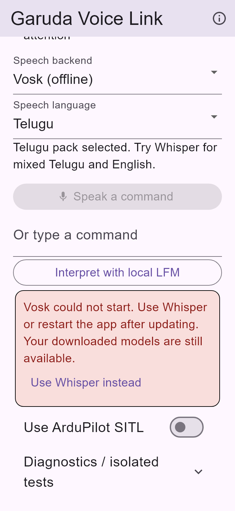

# 0.1.6 release runtime audit — 10 October 2026

**Result:** fixed the demonstrated Vosk startup failure in the optimized Android APK, added runtime recovery, and cleaned up the affected screen. Version **0.1.6+7** is built and passes the checks below. The independent scoped review has no open actionable findings. This audit covers the reported startup/model-status errors and their recording/recovery paths; it does not claim that every possible app defect or speech-recognition error is eliminated.

## Download and update

This is the historical 0.1.6 audit. Use the [0.1.7 emulator QA report](2026-10-10-emulator-qa.md) for the latest build. The [archived 0.1.6 ARM64 release APK](../../../tooling/android-qa/aeronex-0.1.6-release.apk) is **38,116,797 bytes (36.4 MiB)**, package `com.aeronex.app`, version code **7**, Android API **26+**. The [archived debug APK](../../../tooling/android-qa/aeronex-0.1.6-debug.apk) is also retained.

The signing certificate matches the earlier evaluation build. Updating in place preserves app-private models and settings; this bug does not require clearing storage, uninstalling, or downloading the same models again. A missing language pack remains a separate setup requirement. The fixed 2 GiB free-RAM gate remains removed.

Release SHA-256:

```text
940ca934b219d4d28753bd581f2fcbe0c05006e7d531dda650dbde5d5121d916
```

Debug SHA-256:

```text
10da931dd5daff7b60ed05650d39e9e83399777986996ac7a27cec84491e6f6c
```

These use the existing development signing key and are evaluation APKs. Speech models are provisioned separately from the APK.

## Why the screenshots failed

The first screenshot reports `Can't obtain peer field ID for class com.sun.jna.Pointer`. The 0.1.5 release R8 mapping proves that `Pointer.peer` became `c`; it also renamed `Structure.memory` and `PointerType.pointer`. JNA 5.18.1's native `Java_com_sun_jna_Native_initIDs` looks up these Java members by literal name. Failure to find `peer:J` throws the exact screenshot message.

The subsequent `org.vosk.LibVosk` failure follows a failed class initializer in the same process. Models can remain valid on disk while the speech library cannot initialize. Reinstalling those models cannot repair a renamed JNI field.

Neither resolved dependency AAR supplied consumer ProGuard rules. The [upstream Vosk Android demo rules](https://github.com/alphacep/vosk-android-demo/blob/master/app/proguard-rules.pro) preserve JNA. The [JNA native source](https://github.com/java-native-access/jna/blob/5.18.1/native/dispatch.c), old R8 mapping and old configuration are saved in the [audit source directory](../../.superpowers/audits/2026-10-10-vosk-release/).

Earlier host/debug checks did not run optimized Android DEX: the original release fails the saved contract check, while the original debug APK passes. The new release gate now inspects the built APK rather than relying only on debug tests or the presence of native libraries.

## Changes

| Area | Result |
| --- | --- |
| Release packaging | [R8 rules](../../app/android/app/proguard-rules.pro) retain JNA and Vosk classes/members used by JNI and reflection. App optimization remains enabled. |
| Native startup errors | [LocalInferenceBridge](../../app/android/app/src/main/kotlin/com/aeronex/app/LocalInferenceBridge.kt) classifies Vosk `LinkageError` failures as `SPEECH_RUNTIME`, remembers the failure, and avoids repeatedly loading the poisoned class. It releases the model lease and leaves installed files intact. |
| Readiness | [Control screen](../../app/lib/features/flight/presentation/local_control_screen.dart) says **Models ready** for verified selections and **Speech engine needs attention** for a failed selected runtime. It no longer claims that installed models alone prove speech is operational. |
| Recovery | A friendly message and **Use Whisper instead** action replace native class names in normal UI. Recovery remains available after typing clears the last action error. An installed Whisper model is reused; a missing one uses normal model setup. |
| Recording and typing | Known failed Vosk capture is disabled; Whisper and typed interpretation remain usable. A fresh typed-command error takes priority over the persistent Vosk notice. Android language-download actions are limited to the Android recognizer. |
| Diagnostics and copy | Raw native details stay in diagnostics/logs. Main-screen helper copy is shorter, and command state moved into diagnostics. Existing dry-run confirmations still report **NOT SENT**. |
| Release gate | [JNI checker](../../tools/check_jni_contract.py) reads actual defined classes/fields/methods from single or multiple DEX files. It covers all JNA 5.18.1 `Native_initIDs` lookups and app Vosk adapter symbols: **17 classes, 52 members**. [Package checker](../../tools/check_android_package.py) combines this with identity, signing and native packaging checks. |

The broad JNA keep rule retains desktop-only helpers. The first rebuild exposed their missing AWT types; the final rules suppress only `java.awt.Component`, `GraphicsEnvironment`, `HeadlessException` and `Window`. Android does not provide AWT, and this app does not call those helpers. There is no global warning suppression or disabled R8 workaround.

Telugu default, Indian English (`en-IN`), Vosk Telugu/Hindi/Indian English packs, Whisper alternatives, session-aware Finish, reviewed transcripts and the existing model verification/recovery work remain intact. The language and accuracy limits in the [Vosk integration report](2026-10-09-vosk-integration.md) still apply.

## Verification and evidence

| Check | Result | Evidence |
| --- | --- | --- |
| Original optimized 0.1.5 APK | Expected failure: 15 missing/renamed entries in the initial 11-class contract, including `Pointer.peer` | [Release regression](2026-10-10-jna-release-red.json) |
| Original 0.1.5 debug control | Initial contract passes | [Debug control](2026-10-10-jna-debug-control.json) |
| New native/widget regressions before fixes | Expected failures reproduced | [Native red log](2026-10-10-jna-runtime-native-red.log), [widget red log](2026-10-10-jna-runtime-flutter-red.log), [error-priority red log](2026-10-10-jna-error-priority-red.log) |
| Flutter suite | **94 passed** | [Full test log](2026-10-10-jna-flutter-tests.log) |
| Flutter analysis | **No issues found** | [Analysis log](2026-10-10-jna-analysis.log) |
| Android host suite | **74 total: 73 passed, 1 optional network smoke skipped, 0 failures/errors** | [Summary](2026-10-10-jna-native-summary.json), [log](2026-10-10-jna-native-tests.log) |
| Release/debug builds | Both 0.1.6+7 builds completed successfully | [Release build](2026-10-10-jna-release-build.log), [debug build](2026-10-10-jna-debug-build.log) |
| Final release APK | Expected identity/certificate; ARM64 only; ZIP and ELF 16 KiB alignment; expanded JNI contract passes | [Release package report](2026-10-10-0.1.6-release-apk.json) |
| Final debug APK | Same checks pass, including multidex contract | [Debug package report](2026-10-10-0.1.6-debug-apk.json) |
| Compact UI | Recovery stays reachable at 360×780 logical pixels and 1.3 text scale; no overflow exception | Production widget regression plus [preview log](2026-10-10-runtime-preview.log) |
| Independent review | One artifact-guard coverage finding fixed; scoped rereview reports no open actionable findings | [Review and resolution](2026-10-10-release-runtime-review.md) |

The new native tests simulate both screenshot failures and verify model retention, no microphone creation on initialization failure, released model leases, no repeated loading of the failed class, and working Whisper/typed paths. Widget tests verify friendly recovery, button state, error priority and compact layout. Native inventory tests used the locally provisioned real Vosk, LFM/Whisper and Whistle/Needle directories.

The review expanded the initial checker to include the remaining unconditional callback, pointer and FFI-type lookups. A narrow negative probe showed that removing `PointerType.pointer` from parsed definitions passed the baseline checker and fails the expanded one. Both final package reports were refreshed afterward; APK hashes did not change because this was an audit-tool change.

The initial failed R8 build is retained as `2026-10-10-jna-r8-fix-build.log`. A subsequent contract check still pointed to the old 0.1.5 APK because that build had failed; it is explicitly archived as `2026-10-10-jna-interim-old-release-contract.json`. Neither is final-build evidence. The final package reports above are authoritative.

## Visual inspection

The image below is a **simulated Flutter widget render**, scrolled to the recovery card at 1.3 text scale, using a locally loaded readable font. It is not an Android phone screenshot and does not demonstrate live native initialization. The error, explanation and fallback action are readable without horizontal clipping.



## Remaining limits

- **At this audit's completion, no phone was connected and no emulator image was installed.** Subsequent [0.1.7 emulator QA](2026-10-10-emulator-qa.md) executes Android JNI, microphone capture and upgrades with injected audio. Installation over the user's physical-phone copy, phone acoustics, accuracy, latency, memory and thermal behavior remain unmeasured. Follow the [device acceptance steps](mobile-device-matrix.md) for those checks.
- Telugu and mixed-language transcription remain model-dependent. This change fixes native startup and recovery; it does not establish perfect recognition. Use the language selector and review the transcript before interpretation.
- The Android host run emitted a Robolectric temporary-directory cleanup race after test execution (`NoSuchFileException` for `.obsolete`). Gradle completed successfully and test XML has no failures/errors. Existing Gradle/AGP/JVM compatibility notices remain recorded in logs; they were not hidden.
- Prior CMake/CTest results cover three checks on unchanged C++ code. They were not rerun in this release and are not presented as new verification.
- Flight confirmations remain dry runs, including with simulator telemetry. Previously documented model interpretation limitations remain; this audit does not certify flight execution.

Work was completed in the existing implementation worktree, preserving prior uncommitted changes and model files. No commits, resets, merges or pushes were performed.
