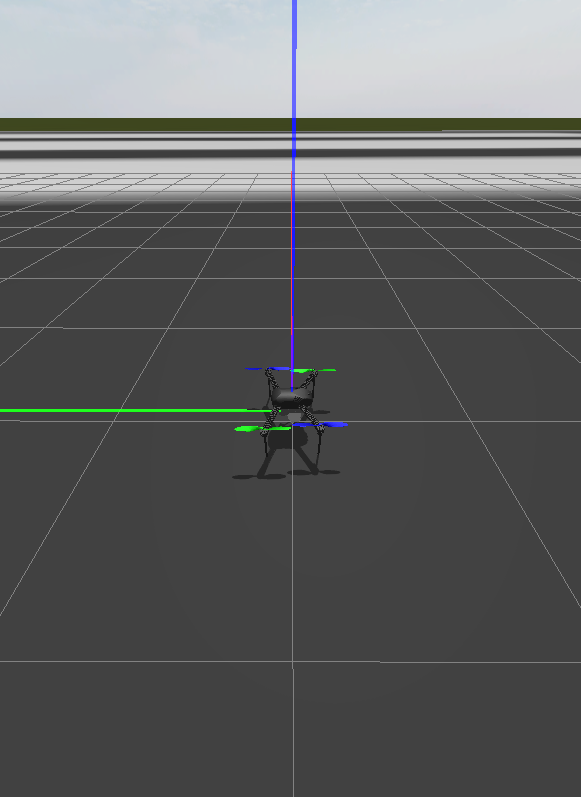

# ArduPilot + Gazebo installation and verification — 10 October 2026

**Result: built and tested in the existing `Ubuntu-24.04` WSL 2 installation.** The simulated Iris completed takeoff, forward movement, BRAKE hold, landing, and disarming. The Windows launcher, Gazebo viewer, app native codec, and Windows-to-WSL UDP route were verified.

Use the [quick-start guide](../simulation/RUN_SIMULATION.md) to run it. The installation is in `/home/drone/aeronex-sim`; the outer Windows workspace has `Start-Simulation.ps1`.

## Installed versions

| Component | Version / revision |
| --- | --- |
| Linux | Existing Ubuntu 24.04.4 LTS, WSL 2 |
| Gazebo Harmonic | Gazebo Sim **8.12.0**, existing system installation |
| ArduCopter SITL | **4.6.3**, tag `Copter-4.6.3` |
| ArduPilot source | `92b0cd788ec29406f26c6f9c31d5ceedbd1cc538` |
| Official ArduPilot Gazebo plugin | `082a0fe231f6e63bc8d1598f1cba461d9e2ea7f5` |
| Python | 3.12.3, dedicated `.venv` |
| MAVProxy | 1.8.75 |
| pymavlink | 2.4.50 |

Both source checkouts were clean after building. [Installed manifest and binary SHA-256 values](../../.superpowers/audits/2026-10-10-wsl-simulation/installed-manifest.json) and the [Python version lock](../../.superpowers/audits/2026-10-10-wsl-simulation/python-requirements.lock.txt) are saved.

## Measured checks

| Check | Result |
| --- | --- |
| ArduCopter build | Passed; native SITL build completed in 3m47.618s |
| Gazebo plugin build | All four plugin libraries built; no unresolved runtime libraries |
| Native CMake/CTest suite | **3/3 passed** |
| Existing basic SITL integration harness | Passed takeoff, native telemetry, forward movement, BRAKE, and completed landing |
| Gazebo world and plugin | Iris world loaded; JSON sensor/actuator exchange worked; physics statistics sampled near real time |
| Complete Gazebo flight check | **PASS**, **67.60 seconds**, including startup readiness |
| Takeoff | 3 m target; measured peak relative altitude **3.04 m** |
| Forward movement | 2 m command; final target error **0.0374 m** |
| Hold | BRAKE mode confirmed with low speed |
| Landing | Landed state confirmed; final altitude 0 m; motors disarmed |
| App codec and telemetry | Native encoder/decoder used through MAVProxy; all six stream requests acknowledged and all seven required telemetry streams received |
| UDP source filtering | Replies received from `127.0.0.1:14550` by test client port `14551`; vehicle identity `1/1` |
| Windows-to-WSL route | **358 datagrams** in a five-second sample; verified quadrotor heartbeat from WSL IP `172.18.95.12`, source port `14550` |
| Gazebo viewer | Launched through WSLg; camera focus and screenshot services succeeded; rendered image inspected |
| Duplicate launch | Rejected while preserving the active instance |
| Stop / cleanup | Passed; all owned child processes exited; ports `9002`, `5760`, `14550`, `14551` were released |

The WSL IP is the address observed during this test and may change after a restart. The simulator was stopped after verification.

Evidence:

- [Full Gazebo flight report](../../.superpowers/audits/2026-10-10-wsl-simulation/verified-flight-check.json)
- [Basic SITL output](../../.superpowers/audits/2026-10-10-wsl-simulation/basic-sitl.log)
- [Windows UDP report](../../.superpowers/audits/2026-10-10-wsl-simulation/windows-udp-check.json)
- [Launcher and cleanup report](../../.superpowers/audits/2026-10-10-wsl-simulation/launcher-check.json)
- [Dependency verification](../../.superpowers/audits/2026-10-10-wsl-simulation/dependency-check.txt)

## Issues found and resolved

1. **Windows path forwarding:** the initial wrapper lost backslashes at the WSL shell boundary. The launcher now uses `wsl --exec` with a normalized path, and both launch and stop were exercised from the outer Windows workspace.
2. **GStreamer build metadata:** the installed LLVM `libunwind` development package satisfied the package dependency but did not provide the `libunwind.pc` metadata needed by GStreamer. The build now uses a private SDK extracted from Ubuntu's `libunwind-dev` package. A temporary package conflict was reversed: the original `libc++-20-dev` and `libunwind-20-dev`, both `1:20.1.2-0ubuntu1~24.04.3`, are installed. `dpkg --audit` reported no issues.
3. **Simulator startup race:** an early EKF-ready flag appeared before sensors and prearm checks completed. An early GUIDED selection could also be overwritten by initial RC setup. The test now waits for full startup sensor/prearm health, selects GUIDED, confirms mode and health, then sends an ordinary arm command. Arming checks remain enabled; no force-arm or bypass is used.
4. **Slow Windows diagnostic probe:** the first probe launched a Linux decoder process for each datagram and fell behind incoming traffic. The corrected measurement captures the datagrams first and decodes the batch, confirming the host route without firewall changes.

The unused Debian import was removed after the user changed the requirement. The completed setup uses the original Ubuntu distro. No Conda environment, global WSL configuration change, firewall exception, system-wide Python installation, app model deletion, or Git commit was made.

## Scope and limits

- This verifies a software aircraft created by the launcher. No physical flight controller or aircraft was connected.
- Android app confirmations still return **NOT SENT**. Flight commands in this report came from the separate simulator integration harness using the native codec.
- The physical Android phone-to-WSL Wi-Fi route remains untested. Default WSL NAT normally requires additional routing for a phone; the guide explains the options.
- This work does not remeasure Telugu or Indian English speech recognition, phone microphone behavior, or local-model interpretation accuracy.
- Upstream Gazebo startup notices about SDF extensions, anti-aliasing, and camera initialization remain in the component logs. The viewer rendered and the flight test passed. The stock precision-landing configuration reported a fallback during landing; ordinary landing and disarming completed.

## Sources

- [Official ArduPilot Gazebo plugin](https://github.com/ArduPilot/ardupilot_gazebo)
- [ArduPilot with Gazebo](https://ardupilot.org/dev/docs/sitl-with-gazebo.html)
- [ArduPilot SITL on Linux](https://ardupilot.org/dev/docs/setting-up-sitl-on-linux.html)
- [Gazebo Harmonic documentation](https://gazebosim.org/docs/harmonic/)
